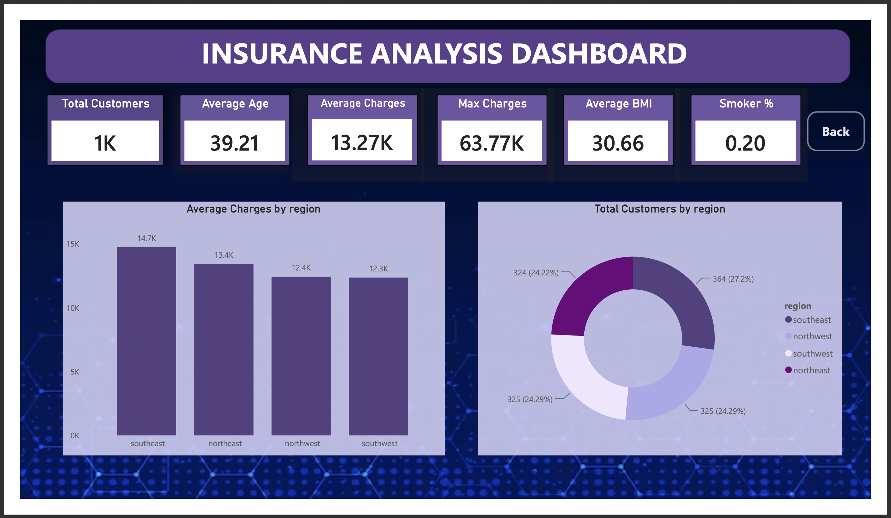
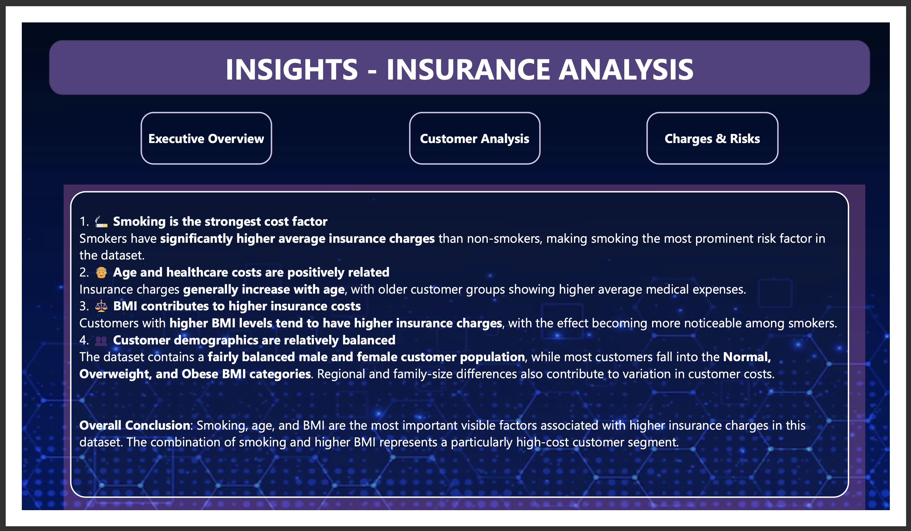
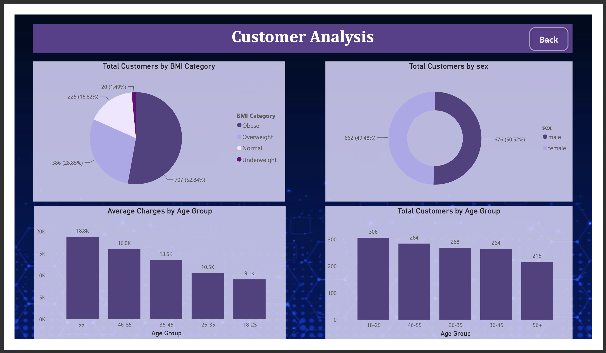
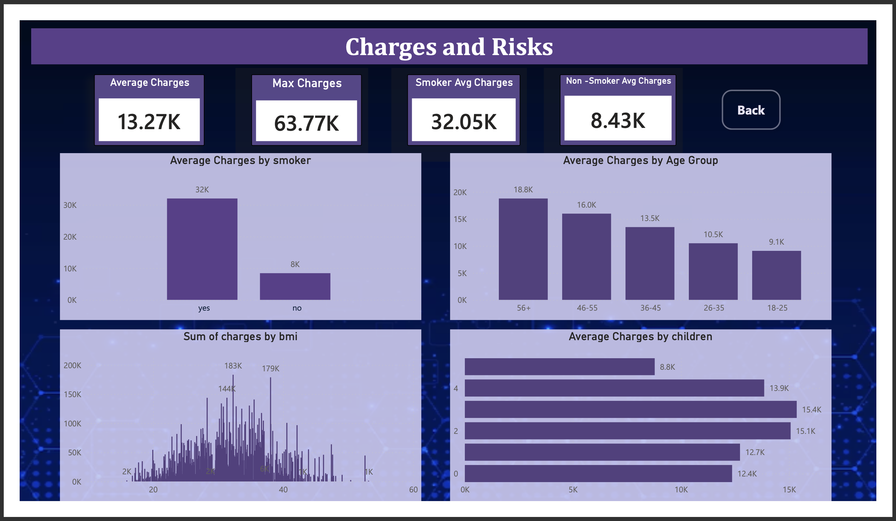

# Insurance-Analysis-Dashboard
Interactive insurance data analysis dashboard built using Power BI.
# Insurance Analysis Dashboard

## Project Overview
This project analyzes insurance customer demographics, medical insurance charges, and risk factors using an interactive dashboard. It helps identify patterns in insurance costs across different customer groups.

## Tools Used
- Microsoft Power BI
- Data visualization
- Data analysis

## Dashboard Pages
1. **Executive Overview** — Key performance indicators, average charges, customer distribution, and regional analysis.
2. **Insights – Insurance Analysis** — Summary of the main findings and important cost drivers.
3. **Customer Analysis** — Customer distribution by BMI category, sex, and age group.
4. **Charges and Risks** — Comparison of charges for smokers and non-smokers, age groups, BMI, and number of children.

## Dashboard Screenshots

### 1. Executive Overview

### 2. Insurance Insights

### 3. Customer Analysis

### 4. Charges and Risks

## Key Performance Indicators
- Total customers: approximately 1,000
- Average insurance charges: approximately 13.27K
- Maximum insurance charges: approximately 63.77K
- Average customer age: 39.21
- Average BMI: 30.66

*Note: These values are based on the dashboard preview and should be checked against the final report before publication.*

## Key Insights
- Smokers have substantially higher average insurance charges than non-smokers.
- Average insurance charges vary across age groups.
- Customer counts can be compared across BMI categories and demographic groups.
- BMI and smoking status are useful variables to investigate when analyzing insurance costs.

## Project Files
- Power BI report (`.pbix`), if included
- Dashboard screenshots
- Dataset, if permitted to share

## Conclusion

The Insurance Analysis Dashboard provides a comprehensive view of customer demographics, insurance charges, and major risk factors using interactive data visualizations. The project helps analyze how age, BMI, smoking habits, gender, and the number of children relate to insurance expenses.

The analysis indicates that smoking status is strongly associated with higher average insurance charges. Age groups and BMI categories also provide useful insights into customer costs and risk patterns. The dashboard presents these findings through an Executive Overview, Customer Analysis, Charges and Risks, and an Insights page.

This project helped me improve my practical skills in data analysis, dashboard development, KPI presentation, and data storytelling using Microsoft Power BI. It also demonstrates how raw data can be transformed into meaningful visual insights that support better understanding and data-driven decision-making.

Overall, this project showcases my ability to organize analytical findings into a clear, interactive, and professional dashboard suitable for a data analytics portfolio.
